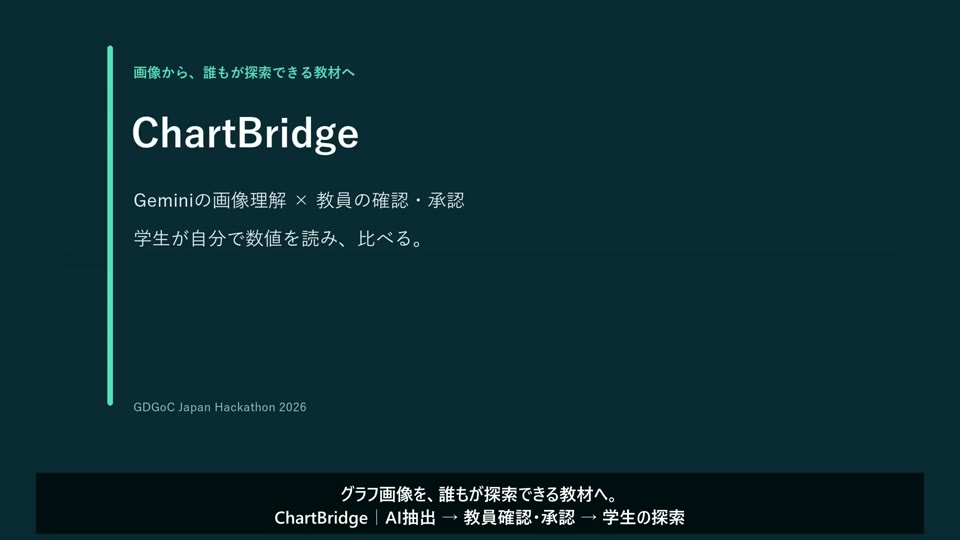

# ChartBridge

## 公開評価データの是正（11月10日）

ChartQA／OECD由来の元表・期待値・再現出力は現行公開版から縮小し、出典・ハッシュ・採点情報・集計を保持しています。製品と過去の実測値は変更していません。**書換え前のコミットURL・キャッシュ等には表データが残る可能性があり、権利確認完了を意味しません。** [公開範囲・再現性・残る確認](docs/submission/RIGHTS_REMEDIATION.md)／[利用条件](evaluation/real-v2/LICENSE_DATA.md)。

## 大阪会場向け提出資料

**チーム：Alpha & Omega ／ 大阪（現地）**

**正式締切：2026年11月10日19:00 JST**

| 資料 | リンク |
|---|---|
| 提出フォルダ（Osaka_Alpha & Omega） | [開く](https://drive.google.com/drive/folders/1SBs445Yn8AM6VA5OnbQ6Jlkdm-ZsBitI) |
| プロダクト説明ドキュメント（Google Docs） | [開く](https://docs.google.com/document/d/1mjmjexApEa5cjBL4bUDA1Wnqmg31SChkbehKajFKrPM/edit) |
| 著作物利用シート（Google Sheets） | [開く](https://docs.google.com/spreadsheets/d/1x73ozWKlA7U-ZEED8p1_jaDY6C2S43hhRPJ3zbJ8RQA/edit) |
| プレゼンスライド（Google Slides） | [開く](https://docs.google.com/presentation/d/1uf1nl6mqSw5fgxw6CNFvn4006zoECtUbovi7M340OpQ/edit) |
| 完成済みデモ動画（MP4） | [開く](https://drive.google.com/file/d/147AmbDXne0s7MZwXLjomASzdDcKxMknh/view) |

Google形式の資料とMP4はユーザーが作成済みです。リンクの掲載だけでは正式提出は完了しません。内容・共有権限・Slides内の動画再生・フォーム送信状況は未確認です。[提出前チェックリスト](submission/README.md#正式提出前の未確認事項)を参照してください。

## 審査員向けデモ

### [▶ 学生用デモを開く — ログイン不要](https://chartbridge-gqe6dtznpq-an.a.run.app/learn/6e24c58117ad4a6e88d610b9b09bb47c)

**まずはこちらを体験してください。アカウント登録・Google Cloudの設定は不要です。** 教員が承認した数値を、学生が表とキーボードで探索する画面です。

1. 表の **12と18**、最大値・最小値を確認します。
2. 「比較する項目」で値18の項目、「差し引く項目」で値12の項目を選び、「数値を比較する」を実行します。差は **6** です。
3. Tabで移動、選択欄は矢印キー、ボタンはEnterまたはSpaceで操作できます。

学生の閲覧・比較ではGeminiを呼び出しません。元画像や未承認教材は表示しません。[未確定値を含む教材例](https://chartbridge-gqe6dtznpq-an.a.run.app/learn/ae12d4de0ab84cd2b5bb8fa61655111f)では、未確定を0として計算しないことも確認できます。

### 教員機能を体験する（教員ログインが必要）

[教員画面を開く](https://chartbridge-gqe6dtznpq-an.a.run.app/)

1. 案内された教員アカウントのメールアドレス・パスワードでログインします。
2. PNG/JPEGの明瞭な単系列縦棒グラフ（全数値ラベル付き、2〜12項目、5 MiB以下）を選び、「グラフを読み取る」を押します。手元に画像がなければ、[動作確認用PNG](backend/tests/fixtures/sample.png)を保存して使えます。この画像の解析も実Geminiを使用します。
3. 元画像とタイトル・項目・数値・単位を照合し、「教員による確認・編集」で必要な箇所を修正します。不明な数値・単位は空欄のまま保留してください。**AI抽出結果はまだ未承認です。**
4. 「未承認として保存」（修正時は「修正を保存」）を押し、元画像との照合確認チェックを付け、「確認して承認版を作成」を押します。承認後の版は変更できません。
5. 「学生向け教材を開く」、または表示された共有URLを別の未ログインブラウザで開き、表と2値比較を確認します。試験には個人情報のない新しい教材を使ってください。

**審査員用アカウントについて：** 利用する場合は、運営・審査員向けの非公開連絡手段でチームから個別に案内します。READMEに共通パスワードや認証情報は掲載しません。アカウント未受領の場合も、上の学生用デモはすぐに体験できます。新規登録だけでは教員権限は付与されません。教員操作にはFirebase認証・教員権限・教材所有者の検証があります。

### デモ動画（約90秒・日本語字幕）

**[▶ 完成版デモ動画を開く（MP4）](output/submission/chartbridge-demo-final.mp4)**

[](output/submission/chartbridge-demo-final.mp4)

約90.4秒・1080p・30fpsの字幕版（ナレーションなし）。実Gemini解析 → 教員の確認・編集・承認 → 未ログインの学生による数値比較と未確定値の計算停止を、実画面で紹介します。認証情報の入力中は非収録で、解析待機は短縮していません。

GitHub上で再生されない場合は、[MP4をダウンロードして再生](https://github.com/Devfest-Hackathon-2026/df-2026-t051/raw/refs/heads/main/output/submission/chartbridge-demo-final.mp4)してください。[SRT字幕](output/submission/chartbridge-demo-final.srt) / [構成・収録内容](docs/submission/DEMO_90_SECONDS.md) / [映像の検査記録](output/submission/chartbridge-demo-final-verification.json)。評価値は[11月9日の最新監査](docs/PRE_SUBMISSION_AUDIT.md)を優先してください。

### 体験時の注意

- 初回表示は起動待ちになることがあります。11月9日のCold Start計測は約8.75秒（1回のみ）、画像選択から解析結果表示は平均4.17秒・最大4.80秒（4回）でした。速度を保証する値ではありません。
- 解析枠は教員ごと2回/分・10回/日、全体30回/日です。429の場合は画面の案内に従って時間を置いてください。401/403の場合はログイン状態と教員権限を確認してください。
- 日本語20枚の最新再測定は完全一致14/20、数値111/145、未確定24件です。AI結果を正解として扱わず、教員確認を必須としています。実スクリーンリーダーによる読み上げは未検証です。

---

改善版を実クラウドで検証し、承認後に一般公開しました。**[11月9日の提出前監査・速度・信頼性](docs/PRE_SUBMISSION_AUDIT.md)**（[11月6日の実装・操作確認](docs/PRODUCTION_AUDIT.md)も保存）を参照してください。過去の評価結果も上書きせず保持しています。

**画像のグラフを、教員が確かめ、学生が自分で探索できる教材へ。**

視覚障害のある学生が、教材のグラフを他者の説明に頼るだけでなく、スクリーンリーダーとキーボードで項目・値・大小・差を確かめられることを目指す教育・アクセシビリティMVPです。

教員の画像登録 → Geminiによる構造化抽出 → 元画像との照合・修正 → 承認版の固定 → 学生の表・2値比較、を一つの流れとして実装しました。AI出力をそのまま正解・公開教材にしません。

## 審査で見ていただきたいこと

1. **Google技術の役割**：Geminiを画像理解、Firebaseを教員認証、Firestore transactionを承認版の固定、Cloud Runを実配信に使用。
2. **実動作と安全性**：実Firebase・Gemini・Firestore・GCS・Cloud Runを使うE2Eあり。未承認教材・他教員の元画像を学生へ渡しません。
3. **学生の自立した操作**：セマンティックな表、キーボード、最大最小・任意2値比較。nullを0として計算せず、学生閲覧でGeminiを再呼出ししません。

## デモと現在の公開状態

- [教員画面](https://chartbridge-gqe6dtznpq-an.a.run.app/) — 通常ブラウザで利用できます。教員操作はFirebase認証・教員権限・教材所有者の確認で保護しています。
- [学生向け教材例：12と18の比較](https://chartbridge-gqe6dtznpq-an.a.run.app/learn/6e24c58117ad4a6e88d610b9b09bb47c) — ログイン不要、承認済みデータだけを返します。
- [操作・最後の手動確認](docs/PRODUCTION_AUDIT.md) / [約90秒の完成デモ動画](output/submission/chartbridge-demo-final.mp4) / [構成・収録記録](docs/submission/DEMO_90_SECONDS.md)。
- 公開版は `chartbridge-00011-suh`、検証済み製品コード `adb182f`。[公開認可・費用・復旧手順](docs/final-audit/PUBLIC_RELEASE_REVIEW.md)。解析はUIDごと10回/日・全体30回/日の予約枠で制限します。

## 対応範囲

- PNG/JPEG、5 MiB以下、32px以上・1200万画素以下の静止画。
- 単系列の縦棒、全数値ラベル付き、2〜12項目。明瞭なアラビア数字の教材を推奨。
- 桁表記と軸単位の関係が曖昧な値はnullに保留し、教員が確認します。明示された単位同士の関係が一意な場合だけ決定的に換算します。
- 横棒、折れ線、複数系列、全数値ラベルのない図、PDF一括処理は対象外。PDFを直接アップロードする機能はありません。
- 学生は承認版のタイトル・単位・数値だけを読み取ります。承認後はアプリAPIから変更できません。

## 実測と制約

| 評価 | 実測 | 解釈 |
|---|---|---|
| 合成固定18枚・107値 | 全体18/18、数値107/107、平均5.666秒 | 評価前に画像・正解・採点を固定。実教材全般の成功率ではない |
| 農林水産省の公開教材6枚・30値 | 初回全体3/6、数値19/30、平均18.145秒 | 桁・単位不整合1例と構造化出力検証失敗2枚を含む。失敗を分母から除外しない |
| 未使用のOECD資料系列25枚・73値 | 候補版の全体21/25、数値73/73、生成HTTP平均3.970秒 | 改善前に分割・コードを凍結して一度評価。出版社／描画様式は共通、日本語教材一般の精度ではない |
| 新規日本語20枚・145値 | 改善前後とも全体15/20、数値121/145、誤った非null値0 | 精度上昇なし。暗黙単位の24セルを安全に保留 |
| 同じ日本語20枚の11月9日再測定 | 全体14/20、数値111/145、null24、誤った非null値0 | 1枚の図全体拒否が増加。既知セットの回帰であり独立評価ではない |
| 別出典の未使用日本語1枚・10値 | 全体1/1、数値10/10 | 最終評価の目標5–10枚には未達。一般精度を示せる量ではない |
| アクセシビリティ | Playwright・axe・アクセシビリティツリーで検証 | 実スクリーンリーダーの音声、実スマートフォンの支援技術は未検証 |

処理時間はローカル正規化・実Gemini・検証込みで、Cloud Run／保存時間は含みません。
拡張評価の生成HTTP時間は待機・token計測を除く別指標であり、上の旧評価の総時間と直接比較しません。
実教材の失敗後に追加した桁表記保留処理は安全のための変更です。6枚の修正後試験を独立評価とは呼びません。
NVDAはユーザーがアンインストールしており、再インストールは要求していません。axeの合格を読み上げの保証とは扱いません。

[合成評価の全個票](evaluation/RESULTS.md) / [実教材の出典・全失敗・時間](evaluation/real-v1/RESULTS.md) / [最新試験・残存リスク](docs/PRE_SUBMISSION_AUDIT.md)。

## 構成・選定・差別化

React + TypeScript + Vite + Tailwind CSS / FastAPI / Gemini / Firebase Authentication / Firestore / GCS / Cloud Run / Secret Manager。

- [システム構成図・Google技術の採用理由](docs/submission/ARCHITECTURE.md)
- [関連手法との比較と本作の焦点](docs/submission/DIFFERENTIATION.md)
- [公開の認証境界・費用リスク](docs/final-audit/PUBLIC_RELEASE_REVIEW.md)
- [OSS・素材・データの利用条件](docs/submission/LICENSES.md)

## ローカル起動と試験

Python 3.12、Node.js 22、pnpm 11.25.0。依存バージョンはrequirements.txt／pnpm-lock.yamlに固定。

```powershell
python -m venv .venv
.\.venv\Scripts\python.exe -m pip install -r backend/requirements.txt
Push-Location frontend
pnpm install --frozen-lockfile
pnpm exec playwright install chromium
Pop-Location
.\scripts\dev.ps1 -Demo
```

別ターミナルで`.\scripts\dev-web.ps1`を起動し、[ローカル画面](http://127.0.0.1:5173/)を開きます。**ローカルデモは固定データで、実Gemini・保存・承認の証拠ではありません。**

```powershell
$env:PYTHONPATH = (Join-Path $PWD 'backend')
.\.venv\Scripts\python.exe -m pytest backend/tests -q
node --experimental-strip-types --test frontend/tests/math.test.ts
Push-Location frontend
node node_modules/typescript/bin/tsc --noEmit
node node_modules/vite/bin/vite.js build
node node_modules/@playwright/test/cli.js test
Pop-Location
```

ブラウザ回帰は専用ポート18000／5174にデモAPI・Viteを自動起動し、手動起動サーバーへ依存しません。
実クラウド試験は別系統で、公開後にはIAMプロキシなしの通常URLでも成功しています。[操作と実試験](docs/PRODUCTION_AUDIT.md)を参照してください。APIキー・パスワードをコードやコマンド履歴へ書かないでください。

## 大会提出について

公式提出先：[Devfest-Hackathon-2026/df-2026-t051](https://github.com/Devfest-Hackathon-2026/df-2026-t051)。[大会README原文](docs/competition-readme.md)の規則を優先します。
公式リポジトリは公開・最終提出用で、GitHub Actions／Pagesは使用禁止。開発履歴を持ち込まず、確認済みの最終ファイルを反映します。
2026-11-05 10:00 JST以降に新規開発し、開始前PoCは流用していません。大阪会場の正式締切は2026年11月10日19:00 JSTです。運営の最新案内を優先します。
秘密情報と提出内容を確認した後、不要な開発履歴を持ち込まず最終ファイルを反映します。

コード：MIT。[LICENSE](LICENSE)。依存OSS・外部データはそれぞれの利用条件を維持します。詳細な開発初期記録は[DEVELOPMENT.md](docs/DEVELOPMENT.md)に保存しています。

---

## 大会公式README原文（提出時保持）

# DevFest Hackathon 2026 提出用リポジトリ

  DevFest Hackathon 2026 のチームの **最終提出用** リポジトリです。提出期限までに、作品のコードと資料をこのリポジトリに置いてください。

  このリポジトリは **公開（public）** です。開催中も、運営・審査員・ほかの参加者が見られます。

  ## はじめに

  1. GitHub から届いた招待を受け入れてください（招待の期限は 7 日です）
  2. このリポジトリを clone して、提出物を置いてください

  招待の期限が切れたときや、メンバーが変わったときは、運営に連絡してください。

  ## 開発用のリポジトリは別に作ることをおすすめします

  このリポジトリでは **GitHub Actions と GitHub Pages が使えません**。CI やデプロイ、Pages での公開をしたいときは、チームで開発用のリポジトリを別に作ってください。

  - 開発用のリポジトリは、チームのメンバーのアカウントや、チームで作った Organization に作ってください
  - 開発はそちらで進めて、提出期限までに最終版のコードと資料をこのリポジトリに push してください
  - 審査はこのリポジトリの内容で行います。開発用のリポジトリにしかないものは、審査の対象になりません
  - デプロイした作品の URL があれば、この README に書いてください

  ## 秘密情報をコミットしない

  API キー・パスワード・サービスアカウントの鍵などは、**絶対にコミットしないでください**。公開リポジトリなので、push
  した時点で誰でも見られます。開発用のリポジトリから持ってくるときも、履歴ごと push すると、過去のコミットに含まれる秘密情報も公開されます。

  - 秘密情報は `.env` や `.dev.vars` などに書き、コミットしない（`.gitignore` に入れてあります）
  - 誤って push したら、すぐにキー（鍵）を無効にして作り直し、運営に連絡してください。履歴から消すだけでは不十分です
  - GitHub の push protection が、よく知られた形式のキーの push を止めることがあります。止められたら、そのキーをコミットから外してください

  ## 提出

  提出の方法と締切は、運営からの案内に従ってください。提出期限を過ぎると、このリポジトリは読み取り専用になり、push できなくなります。

  ## ライセンス

  [MIT License](LICENSE) です。ほかのライセンスにしたいときは、LICENSE を書き換えてください。
