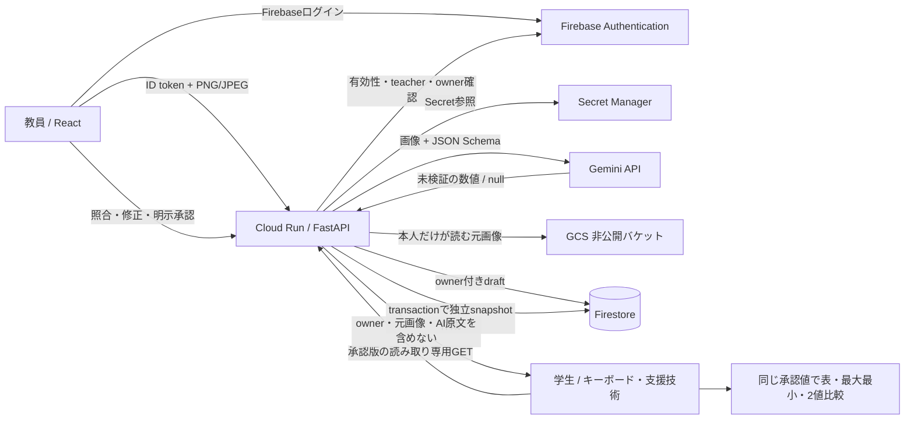

# システム構成とGoogle技術の採用理由

現状はCloud Run IAMが最外層を非公開保護。審査用公開は別途承認前で、[公開案](../PUBLICATION_PLAN.md)に分離した。

| Google技術 | 課題への役割 | 採用理由・境界 |
|---|---|---|
| Gemini | グラフ画像から構造化抽出 | タイトル・項目・値・単位をJSON Schemaで受ける。正確性は保証しないので教員が確認 |
| Firebase Authentication | 教員の本人性・権限 | Admin SDKでtoken期限・署名・失効を確認。teacher claimは管理者だけが付与 |
| Firestore | 下書きと独立した承認版 | owner認可、version競合検知、承認transactionを一箇所で管理 |
| Cloud Run | React＋FastAPI配信 | 同一origin・単一コンテナで運用。Cloud Buildによるsource deploy、ローカルDocker不要 |
| GCS | 元画像の再照合 | 非公開バケットと認可APIを通し、学生の読取データへ混ぜない |
| Secret Manager | Geminiキー管理 | ブラウザ・ソース・ビルド引数へキーを渡さず、固定バージョンを実行時参照 |

比較計算は通常のTypeScript関数で行い、学生閲覧時にGeminiを再呼出ししない。値のnullを0へ変えず、確定値が1件だけの場合に全体の最大最小を主張しない。
FirestoreサーバーSDKはRulesをバイパスするため、API側の認可を省略しない。承認版はアプリAPIから変更不能だが、プロジェクト管理者の直接DB操作まで物理的に禁止する設計ではない。

## 公開後の境界（2026-11-06）

Cloud Runの外側はユーザー承認後に一般公開。教員APIはFirebase token／teacher／ownerを必須とし、学生APIは承認snapshotだけを返す。Firestore transactionのJST日次解析予約、公開GETの制限・承認版キャッシュ、入力token上限を追加。Firestore Rules deny-allとGCS非公開を維持した。詳細・実測は [最新監査](../PRODUCTION_AUDIT.md) を参照。
